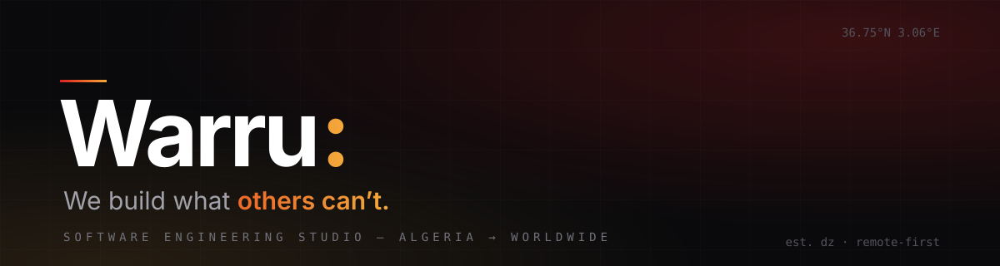

<div align="center">
  
</div>

```console
$ whoami
warru — software engineering studio · dz → worldwide

$ cat manifesto.txt
The systems nobody else wants to touch. Platforms that needed to scale
yesterday. File formats that get rejected if a single byte is wrong.
That is where we work — and why clients call us.
```

## Currently shipping

```
├── DAS Express ────────── das.warru.dev
│   Micro-SaaS: a year of payroll data → CNAS-compliant declaration
│   files. Validated byte-for-byte — "close enough" gets rejected.
│
├── Numera Suite
│   Desktop payroll engine (IRG · CNAS · every DZ rubric), verified
│   line-by-line against the legacy system it replaces.
│
├── DAS Desktop
│   Same engine, offline-first Tauri. Client data never leaves
│   the machine. One codebase → web + desktop.
│
└── Forquant
    FX data backbone — COT reports, sentiment and calendars,
    scraped → normalized → served to signal pipelines.
```

## Not our thing

> Pitch decks. "Strategic alignment workshops." Software that demos
> beautifully and dies at 3am.

## Stack

`TypeScript` `Next.js` `React` `Go` `Rust` `Tauri` `Python` `Postgres` `Prisma` `Tailwind` `Framer Motion` `WebGL`

## Talk to us

Got a problem nobody else can solve? Tell us what's broken, what's slow,
or what doesn't exist yet.

**hello@warru.dev** — response within 24h · EN / FR / AR · remote-first

---

<div align="center">
<sub>Warru. Built by us, for the ones who build.</sub>
</div>
